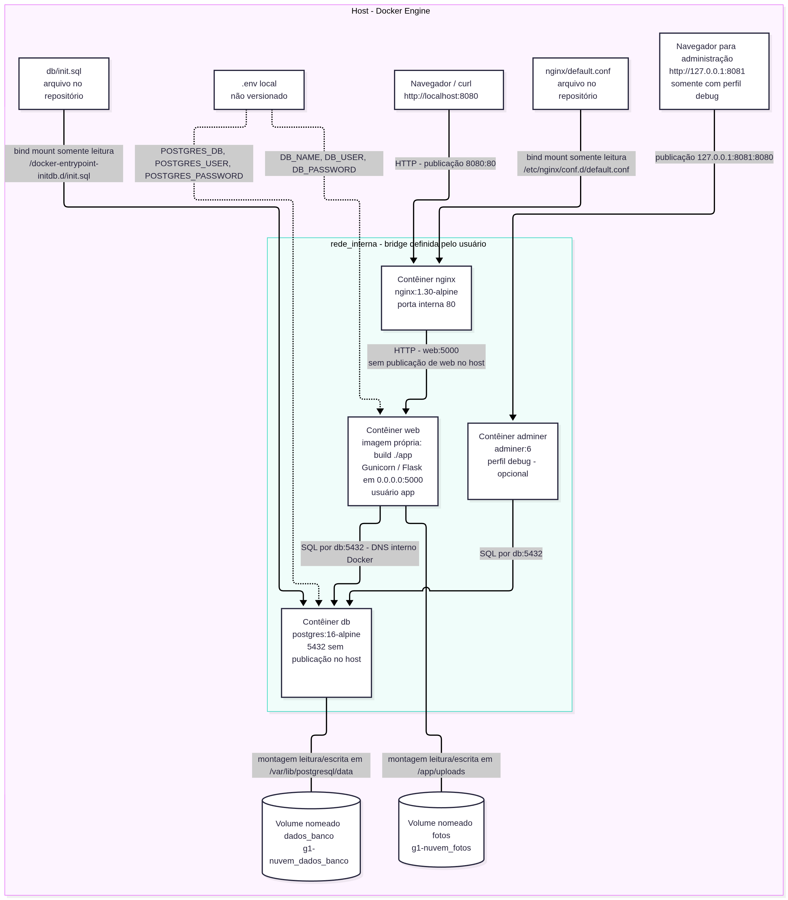

# Achados & Perdidos — G1 de Computação em Nuvem

Ambiente da API Flask com Gunicorn, PostgreSQL e armazenamento persistente das
fotos. A aplicação é fornecida pelo enunciado; a infraestrutura usa Docker Compose.
O objetivo é permitir que outra equipe execute o protótipo e compreenda as
configurações antes de planejar sua migração para a nuvem.

## Estrutura e documentação

```text
G1-Nuvem/
├── AGENTS.md
├── G1-CN-2N.pdf
├── app/
│   ├── app.py
│   ├── requirements.txt
│   ├── Dockerfile
│   └── .dockerignore
├── db/
│   └── init.sql
├── docs/
│   ├── ARQUITETURA.md
│   ├── arquitetura.png
│   ├── REVISAO_FINAL.md
│   ├── RELATORIO.md
│   ├── REFLEXAO.md
│   ├── BONUS.md
│   └── evidencias/
├── nginx/
│   └── default.conf
├── docker-compose.yml
├── .env                 # somente local; não entregar
├── .env.example
├── .gitignore
└── README.md
```

A pasta raiz local mantém o nome `G1-Nuvem`; a organização interna segue a
estrutura apresentada como `achados-perdidos` no enunciado. Os arquivos
`app/app.py`, `app/requirements.txt` e `db/init.sql` foram preservados.

| Artefato | Conteúdo |
| --- | --- |
| A1 — este README | Preparação, execução, testes, rotas e ciclo de parada/remoção. |
| [A2 — Arquitetura](docs/ARQUITETURA.md) | Imagem PNG e fonte Mermaid com host, rede, portas, contêineres e montagens. |
| [A3 — Relatório técnico](docs/RELATORIO.md) | Dockerfile, Compose, caminho do POST e ciclo de vida dos volumes. |
| [A4 — Evidências](docs/evidencias/README.md) | Índice com legendas, saídas reais e imagens dos ensaios. |
| [A5 — Reflexão](docs/REFLEXAO.md) | Sete respostas e tabela de equivalência Azure, AWS e Google Cloud. |
| [Bônus](docs/BONUS.md) | Proxy reverso, backup com restauração e Adminer no perfil `debug`. |

## Arquitetura



A imagem também pode ser [aberta em resolução original](docs/arquitetura.png).
O [fonte Mermaid e a explicação do diagrama](docs/ARQUITETURA.md) permanecem disponíveis para edição.

## Pré-requisitos

Docker Engine em execução e Docker Compose com o comando `docker compose`.
Seu usuário precisa ter permissão para acessar o Docker. Não é necessário instalar
Python, PostgreSQL ou as dependências da aplicação no computador.
Os exemplos abaixo usam Bash no Linux e `curl` para testar a API.
No PowerShell, use `curl.exe` e adapte os caminhos dos arquivos.

## Configurar e subir

Para obter o projeto pelo GitHub:

```sh
git clone https://github.com/lucasmotareis/G1-Nuvem.git
cd G1-Nuvem
```

Na pasta do repositório, crie a configuração local a partir do exemplo. Se já
houver um `.env` configurado, preserve-o em vez de sobrescrevê-lo:

```sh
cp .env.example .env
docker compose config --quiet
docker compose up -d --build
docker compose ps
```

O exemplo contém valores fictícios suficientes para o teste inicial. Substitua-os
antes de usar fora do exercício. O `.env` é ignorado pelo Git e não deve ser
incluído na entrega. O Compose lê as três variáveis `POSTGRES_*` e repassa os mesmos
valores ao banco e às variáveis `DB_NAME`, `DB_USER` e `DB_PASSWORD` da aplicação.
Evite salvar a saída de `docker compose config` sem `--quiet`, pois ela pode revelar
os valores resolvidos, incluindo a senha.

A API fica em `http://localhost:8080`. Na versão com bônus, `nginx` publica
`8080:80` e encaminha para `web:5000`. `web` e `db` não publicam porta no host.
A aplicação se conecta a `db:5432` pela bridge `rede_interna`. O Compose aguarda
o banco saudável (`pg_isready`) antes de iniciar `web`, e aguarda o healthcheck
HTTP de `web` antes de iniciar o Nginx. Os serviços usam `restart: unless-stopped`.
O endereço `/` não possui página inicial: utilize as rotas da tabela abaixo.

O volume `dados_banco` guarda o PostgreSQL em `/var/lib/postgresql/data` e o volume
`fotos` guarda os arquivos em `/app/uploads`. O Dockerfile prepara esse diretório
para o usuário `app`, que executa o Gunicorn. O script `db/init.sql` é montado
somente para leitura e executado na inicialização de um banco vazio.

## Testar a API

```sh
curl -i http://localhost:8080/health
curl -i http://localhost:8080/itens
curl -i 'http://localhost:8080/itens?local=biblio'
curl -i http://localhost:8080/estatisticas
```

Com o banco acessível, `/health` deve retornar HTTP 200 com `status: "ok"` e
`banco: "conectado"`. Um banco novo deve conter os três itens de `db/init.sql`.
Para cadastrar um item, você pode usar a imagem de teste sem dados pessoais
incluída no repositório:

```sh
curl -i -X POST http://localhost:8080/itens \
  -F 'descricao=Objeto de teste' \
  -F 'local=Biblioteca' \
  -F 'foto=@docs/evidencias/foto-teste-1.png'
curl -i http://localhost:8080/itens
curl -i http://localhost:8080/estatisticas
docker compose exec web whoami
docker compose logs web --tail 20
```

O cadastro deve retornar HTTP 201. A listagem retorna o caminho `/fotos/<nome>`;
abra `http://localhost:8080/fotos/<nome>` no navegador para conferir a imagem.
O comando `whoami` deve retornar `app`.
O cadastro sem foto também é aceito: basta omitir o argumento `-F 'foto=@...'`.

| Método | Rota | Função |
| --- | --- | --- |
| GET | `/health` | Verifica a conexão com o banco. |
| GET | `/itens` | Lista os itens cadastrados. |
| GET | `/itens?local=texto` | Filtra os itens por trecho do local. |
| POST | `/itens` | Recebe formulário multipart com `descricao`, `local` e `foto` opcional. |
| GET | `/fotos/<nome>` | Retorna a foto armazenada. |
| GET | `/estatisticas` | Retorna as quantidades de itens e fotos. |

## Parar e remover

Para parar os contêineres, mantendo os contêineres e os volumes:

```sh
docker compose stop
docker compose start
```

Para remover contêineres e a rede e depois recriá-los, preservando os volumes:

```sh
docker compose down
docker compose up -d
```

Somente no ambiente de teste, quando os dados puderem ser descartados:

```sh
docker compose down -v
docker compose up -d
```

**`down -v` apaga os volumes do banco e das fotos.** Na próxima subida,
`init.sql` recria os três itens de exemplo; os itens cadastrados e as fotos
anteriores não são recuperados. Não use essa opção como parada habitual.

## Usar os bônus

O Nginx já faz parte da subida padrão. A configuração está em
[nginx/default.conf](nginx/default.conf), e a verificação de sintaxe pode ser feita
com `docker compose exec nginx nginx -t`.

Para ativar o painel do banco, que não sobe por padrão:

```sh
docker compose --profile debug up -d
```

Abra `http://localhost:8081`, selecione PostgreSQL, use servidor `db` e os dados
do seu `.env`. A porta do painel está vinculada somente a `127.0.0.1`. Para
desativá-lo, use `docker compose --profile debug stop adminer` e
`docker compose --profile debug rm -f adminer`.

O [roteiro de backup](docs/BONUS.md) mostra como criar `backups/fotos.tar.gz`
com um contêiner temporário `docker run --rm`, restaurar em um volume novo e
comparar os hashes. `backups/` é ignorado pelo Git. Esse procedimento copia
somente fotos; o banco exige uma estratégia de backup própria.

## Evidências e entrega

As saídas reais estão no [índice de evidências](docs/evidencias/README.md).
Os registros 01 a 17 documentam a arquitetura básica. Os registros a partir de
18 documentam a versão com bônus; os resultados antigos não devem ser confundidos
com o estado atual das portas e do proxy. A reflexão distingue o comportamento da escala
antes e depois da inclusão do Nginx.

A entrega será pelo [repositório no GitHub](https://github.com/lucasmotareis/G1-Nuvem),
sem pacote do projeto. Antes de enviar esse link no ambiente virtual, publique
as alterações locais com commit e push e confira no GitHub se o README, a imagem
`docs/arquitetura.png`, os documentos e as evidências aparecem na versão enviada.
O professor precisa ter acesso ao repositório; se ele for privado, conceda esse acesso.
O `.env` e os backups locais devem continuar ignorados; `.env.example` faz parte da entrega.

A [revisão final contra o PDF](docs/REVISAO_FINAL.md) relaciona os requisitos aos
arquivos e testes. As equivalências em nuvem são propostas: nenhum recurso de
nuvem foi provisionado.

## Checklist de entrega verificado

- [x] `docker compose up -d --build` funciona em pasta recém-clonada após copiar `.env.example` para `.env`: [ensaio 23](docs/evidencias/23-clone-e-aceite.txt).
- [x] `/health` retorna `status: "ok"` e `banco: "conectado"`: [ensaios 18 e 23](docs/evidencias/23-clone-e-aceite.txt).
- [x] Nenhuma senha real no Dockerfile, Compose, código ou evidências; `.env` ignorado e não rastreado: [auditoria 25](docs/evidencias/25-auditoria-entrega.txt). O exemplo contém somente valores fictícios.
- [x] O banco não publica porta no host: [inspeção 22](docs/evidencias/22-persistencia-com-proxy.txt).
- [x] `whoami` retorna `app` e o UID é diferente de zero: [ensaio 23](docs/evidencias/23-clone-e-aceite.txt).
- [x] Itens e fotos sobrevivem a `down` e `up -d`, com IDs, URLs e hashes preservados: [ensaios 22 e 23](docs/evidencias/23-clone-e-aceite.txt).
- [x] README com roteiro testado do zero: [ensaio 23](docs/evidencias/23-clone-e-aceite.txt).
- [x] Diagrama com rede, volumes, caminhos, bind mounts e portas: [PNG](docs/arquitetura.png) e [Mermaid](docs/ARQUITETURA.md).
- [x] Relatório com as partes (a), (b), (c) e (d): [relatório técnico](docs/RELATORIO.md).
- [x] Evidências reais nomeadas e legendadas: [índice](docs/evidencias/README.md).
- [x] Sete reflexões e tabela dos três provedores completas: [reflexão](docs/REFLEXAO.md).

O clone do ensaio 23 foi criado a partir de um snapshot Git temporário dos
arquivos atuais. O [manifesto operacional](docs/evidencias/23-manifesto-operacional.json)
identifica o commit de teste e os hashes dos arquivos usados para executar o
ambiente, comparados novamente com os arquivos atuais na
[conferência 26](docs/evidencias/26-conferencia-final.txt). Os ensaios incluíram
todas as rotas, parada/retomada e as três situações da Tarefa 5 com volumes novos.
O projeto original foi preservado e retomado com seis itens e duas fotos.
O Adminer terminou desativado, e a aplicação fornecida permaneceu intacta.

O ensaio 23 é uma validação local e não comprova publicação no GitHub.
Commit, push e acesso do professor são a etapa de entrega; os testes locais
não substituem essa conferência do repositório remoto.
