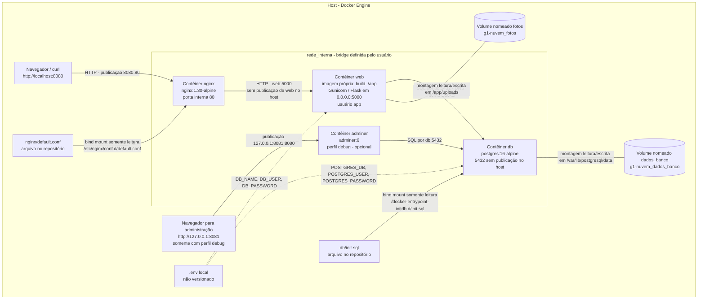

# Arquitetura do ambiente

O host executa o Docker Engine. Na versão com bônus, somente o Nginx publica a
porta 8080 para a API; ele encaminha as requisições para `web:5000`. Dentro da
bridge `rede_interna`, `web` encontra o PostgreSQL pelo nome `db`, na porta 5432.
`web` e `db` não publicam porta no host. O Adminer é opcional e usa somente a
porta local `127.0.0.1:8081` quando o perfil `debug` é ativado.

## Imagem da arquitetura

[Abra a imagem em resolução original](arquitetura.png). A imagem fornecida pelo
aluno foi incluída sem alterações; ela representa a configuração com os bônus.

## Fonte editável em Mermaid

Dentro do limite `rede_interna` ficam `nginx`, `web` e `db`, além de `adminer`
quando habilitado. Os clientes, o arquivo `.env`, os arquivos SQL/configuração
e os volumes estão fora desse limite: os volumes são
armazenamento gerenciado pelo Docker, e os arquivos locais pertencem ao host.
As linhas de montagem representam acesso ao sistema de arquivos, não tráfego de
rede. As setas tracejadas representam configuração injetada nos contêineres.

O healthcheck de `db` executa `pg_isready`. O Compose inicia `web` depois que essa
verificação indica banco saudável; o Nginx aguarda o healthcheck HTTP de `web`.
Todos os serviços usam `restart: unless-stopped`.

Na arquitetura básica, `web` publicava `8080:5000`. O bônus transfere a publicação
para `nginx` com `8080:80`, mantendo a aplicação e o banco na mesma rede e com os
mesmos volumes. O upstream do proxy acompanha os endereços de `web` pelo DNS do
Docker, incluindo os endereços das réplicas.

Os nomes reais recebem o prefixo do projeto Compose, `g1-nuvem_`, no ambiente
testado. A [inspeção da versão com proxy](evidencias/22-persistencia-com-proxy.txt)
registra a rede, os volumes, as portas e o usuário. As
[inspeções básicas](evidencias/15-inspecao-infraestrutura.txt) permanecem como
histórico da etapa anterior. Veja o fluxo de cadastro e o ciclo de vida no
[relatório técnico](RELATORIO.md) e os procedimentos extras em [BONUS.md](BONUS.md).
