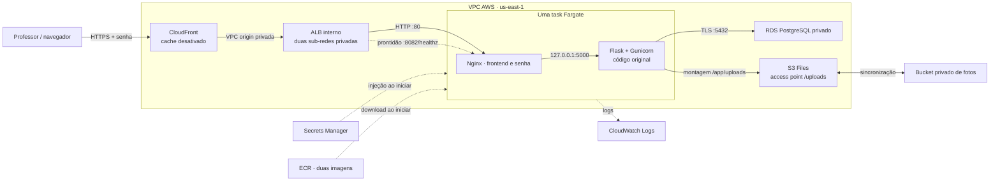

# Apresentação — Achados & Perdidos na AWS

Implantação do laboratório em 26/10/2026, conta `429100831877`, região `us-east-1`.

## Acesso

**[Abrir a aplicação](https://di54x57cfrcxq.cloudfront.net/)**.
Usuário: **visitante**. Use a senha compartilhada configurada no Secrets Manager.
A senha não está neste documento. Para apresentar, use Chrome ou Edge.

Estado validado: **seis itens e duas fotos**, uma task saudável e CloudFront
`Deployed`. Os três primeiros itens vieram do SQL original; os demais são
cadastros fictícios dos testes. A substituição da task preservou todos eles.

[Console da distribuição CloudFront](https://us-east-1.console.aws.amazon.com/cloudfront/v4/home?region=us-east-1#/distributions/E3TRUXI3LTMDAF).

## Identificadores para localizar os recursos

| Recurso | Identificação |
| --- | --- |
| Cluster / service | `g1-achados` / `achados-web` |
| Task definition final | `achados-web:2`; [JSON sem senhas](../infra/aws/task-definition.us-east-1.json) |
| CloudFront | `E3TRUXI3LTMDAF`; [entrada da distribuição](../infra/aws/cloudfront-distribution.json) |
| VPC origin | `vo_0ZwUL6nFfRzDiTxcZa6ToO` |
| ALB / target group | `g1-achados-interno` / `g1-achados-frontend` |
| Sub-redes privadas do ALB | `subnet-0621bf39acd446843` e `subnet-0c7f02d7085901ebd` |
| Tabela de rotas privada | `rtb-077b6411714253e64`; somente rota local |
| Novo grupo do ALB | `sg-0fbbc2ee7c0dcfb17` / `g1-cloudfront-alb-sg` |
| RDS | `g1-achados-db` |
| S3 Files | `fs-03cc16c6148b70bad` |
| Bucket de fotos | `g1-achados-fotos-429100831877-20261026` |
| Bucket de logs | `g1-achados-logs-429100831877-20261026`; expiração de objetos em sete dias |
| Logs dos contêineres | `/ecs/achados-web`; retenção de sete dias |

Não foi criado ECS Gateway: a operação ainda não era reconhecida pelo MCP.
A alternativa CloudFront com VPC origin forneceu HTTPS sem comprar domínio.
Foi criado um grupo exclusivo para o novo ALB, preservando as regras anteriores.
O MCP continuou autenticado como root; o usuário IAM humano não foi alterado.

## O que mostrar em cinco minutos

1. Abra a URL HTTPS e entre com o usuário e a senha. Mostre a lista e o indicador
   de conexão com o banco.
2. Busque por `biblio`: a interface chama a rota original `GET /itens?local=biblio`.
3. Cadastre um objeto fictício com uma imagem de teste. Mostre o novo registro e
   amplie a foto. A interface envia `POST /itens` multipart para o Flask original.
4. Abra as rotas `/health` e `/estatisticas` na mesma URL. Mostre os JSONs e explique
   que interface e API usam a mesma origem e exigem senha.
5. Mostre o diagrama abaixo e as evidências. O ensaio de substituição da tarefa
   já comprovou persistência; não é necessário reiniciar recursos durante a apresentação.

## Como explicar cada recurso

| Recurso | Papel nesta aplicação |
| --- | --- |
| ECR | Guarda as duas imagens: backend `aws-v1` e frontend `aws-v3`. |
| ECS/Fargate | Executa Nginx e Flask/Gunicorn na mesma task; o service mantém uma task ativa. |
| RDS PostgreSQL | Guarda os registros e substitui o contêiner local do banco. |
| S3 Files + S3 | Monta `/app/uploads` e sincroniza as fotos com um bucket privado, preservando o código de arquivos do professor. |
| Secrets Manager | Entrega separadamente as credenciais do banco e a senha de entrada. |
| VPC e security groups | Permitem somente as comunicações necessárias entre os componentes. |
| ALB interno | Encaminha HTTP privado ao frontend e verifica a prontidão na porta 8082. |
| CloudFront | Fornece domínio HTTPS da AWS, certificado e conexão privada à origem; o cache está desativado. |
| CloudWatch Logs | Centraliza os logs do backend, frontend e inicialização, com retenção de sete dias. |



O IP público da task é utilizado para saída aos serviços AWS; as portas da
aplicação não ficam abertas para a internet. O ALB não possui endereço público.
O banco e as fotos também não são públicos. A senha é validada pelo Nginx.

## Verificação e evidências

- [Inicialização: três registros, TLS e exit code 0](evidencias/aws/07-inicializacao-rds.json).
- [Rotas por curl.exe: saúde, filtro, cadastro, autenticação e foto](evidencias/aws/09-rotas-api.json).
- [Interface no Chromium: testes reais e cenários simulados identificados](evidencias/aws/frontend/30-frontend-testes.json).
- [Autenticação: acesso anônimo/incorreto negado e acesso válido liberado](evidencias/aws/acesso/35-autenticacao-testes.json).
- [Captura desktop do ambiente AWS](evidencias/aws/frontend/30-frontend-desktop.png)
  e [captura para celular](evidencias/aws/frontend/30-frontend-mobile.png).
- [Persistência: mesmos seis IDs e hashes das duas fotos após substituir a task](evidencias/aws/14-persistencia-comparacao.json),
  com [consultas antes](evidencias/aws/10-persistencia-antes.json)
  e [depois](evidencias/aws/11-persistencia-depois.json).
- [Fotos sincronizadas no S3](evidencias/aws/12-sincronizacao-s3.json)
  e [HTTPS/cabeçalhos de proteção](evidencias/aws/13-https-cabecalhos.json).
- [Service, distribuição, rede, logs e preços conferidos](evidencias/aws/08-ecs-cloudfront.json).
- [Roteiro completo de implantação e diagnóstico](GUIA_AWS.md).

Os arquivos `app/app.py`, `app/requirements.txt` e `db/init.sql` permanecem
originais. A mudança no Nginx v3 reconhece HTTPS terminado no CloudFront;
não converte a aplicação para Django e não exige instalar Python no computador.

## Testes reproduzíveis

Os testes AWS com curl ficam em [tests/aws-api.ps1](../tests/aws-api.ps1).
Eles exigem uma URL HTTPS e `TEST_ACCESS_PASSWORD` no ambiente. A senha é enviada
ao curl por stdin, sem fazer parte dos argumentos. O modo `-ReadOnly` apenas
consulta registros, estatísticas e fotos, permitindo comparar a persistência.
Os testes de navegador existentes aceitam `TEST_BASE_URL` e salvam seus resultados
em `TEST_OUTPUT_DIR`; os cenários com respostas simuladas são identificados.

Para demonstrar manualmente no PowerShell, o curl pede a senha sem gravá-la no comando:

```powershell
$ApiBase = 'https://di54x57cfrcxq.cloudfront.net'
curl.exe --user visitante "$ApiBase/health"
curl.exe --user visitante "$ApiBase/itens?local=biblio"
curl.exe --user visitante "$ApiBase/estatisticas"
```

## Custos e encerramento

Os recursos devem permanecer ativos durante a apresentação. Depois, siga
[o encerramento do laboratório](GUIA_AWS.md#13-encerrar-o-laboratório-e-controlar-custos).
Não basta fechar o navegador, parar uma task ou definir `desiredCount=0`:
RDS, ALB, armazenamento e outros recursos continuam cobrando.

Preços consultados pela API em 26/10/2026: a task de 0,25 vCPU/0,5 GB custa
US$ 0,0123425/h; o ALB custa US$ 0,0225/h mais LCUs. Somados ao RDS
de US$ 0,016/h, são US$ 0,305055 para seis horas, **antes** de armazenamento,
IPv4, segredos, CloudFront, logs, tráfego e impostos. Isso é uma estimativa de
um intervalo de funcionamento, não o valor acumulado da conta nem uma garantia
de gratuidade. Não foi contratado plano mensal com compromisso ou comprado domínio.

Na exclusão, inclua a distribuição CloudFront, VPC origin, entrega de logs,
política de response headers, bucket de logs, ALB, target group e a rede privada
exclusiva, além dos recursos das etapas anteriores. Preserve apenas os backups
que deseja manter e pagar. A remoção não será executada antes da apresentação.

## Limites do laboratório

A senha é compartilhada, sem usuários individuais. Use apenas dados e imagens
fictícios. O backend mantém os três alertas HIGH de pacotes do sistema registrados
na [etapa 6](AWS-ETAPA-06.md); o frontend v3 passou na varredura básica sem achados.
Não há WAF pago ou Shield Advanced contratado para esta demonstração temporária.
Uma publicação duradoura exige tratar os alertas, rever autenticação, limites de
upload, proteção contra abuso e operação contínua.

O certificado padrão `cloudfront.net` é gerenciado pela AWS. A configuração
retornada pela AWS usa `MinimumProtocolVersion: TLSv1` para esse certificado,
mesmo quando se solicita uma política mais recente. Não se afirma que versões
antigas de TLS foram desabilitadas. Para uma publicação duradoura, usar domínio
e certificado próprios permite selecionar uma política mínima TLS 1.2 ou superior.
