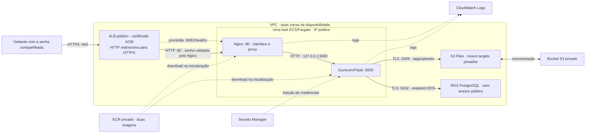

# Achados & Perdidos na AWS — roteiro de laboratório

Roteiro preparado em 26/10/2026 a partir da [reflexão, seção 5.1](REFLEXAO.md#51--do-ambiente-local-para-a-nuvem),
do código atual e das fontes oficiais vinculadas abaixo. **Execução parcial:**
a etapa 3 configurou a rede, e a etapa 4 criou o RDS e os dois segredos em
26/10/2026, com o banco confirmado como **Available**. Os resultados estão registrados em
[rede](AWS-ETAPA-03.md) e [banco e segredos](AWS-ETAPA-04.md).
A etapa 5 criou o bucket e o S3 Files, com os dois mount targets **Available**,
conforme o [registro do armazenamento](AWS-ETAPA-05.md). A aplicação ainda não
executa no ECS. A etapa 6 publicou as imagens no ECR e corrigiu os
pacotes do frontend, conforme o [registro das imagens](AWS-ETAPA-06.md).
A etapa 7 criou as [duas roles IAM do ECS](AWS-ETAPA-07.md), com políticas
restritas e validadas. O teste real de gravação dos logs continua pendente.
A etapa 8 criou o cluster e o grupo de logs e registrou **`achados-web:1`**,
sem iniciar tasks, conforme o [registro da definição](AWS-ETAPA-08.md).

## 1. O caminho recomendado para começar

Para aprender cada serviço sem administrar uma máquina virtual, use o console
AWS para criar os recursos e o PowerShell local para enviar a imagem e executar
as tarefas. Use uma tarefa Fargate com dois contêineres e dados fictícios.
O acesso compartilhado exige a senha no Nginx e **HTTPS no ALB antes de enviar
essa senha pela internet**. Será necessário um domínio que você possa validar
no ACM; o DNS padrão do ALB não substitui essa validação.

| Peça local | Serviço usado | O que você administra |
| --- | --- | --- |
| `web` / Gunicorn e frontend Nginx | ECS com Fargate | Duas imagens na mesma task, variáveis e quantidade de tarefas. |
| PostgreSQL + `dados_banco` | RDS for PostgreSQL | Banco, acesso, tamanho e política de backup. |
| `fotos` | S3 + **S3 Files** | Bucket privado, sistema de arquivos, permissões e montagem. |
| `rede_interna` | VPC e security groups | Conectividade e portas permitidas. |
| `.env` | Secrets Manager | Dois segredos separados: banco e senha de entrada. |
| Imagem local | ECR privado | Versões da imagem enviada pelo Docker. |

Uma **task definition** é a receita de execução do contêiner. Uma **task** é uma
execução dessa receita. Um **service** mantém a quantidade desejada de tasks,
substituindo as que falham. Um **cluster** organiza esses recursos no ECS.



A seção 5.1 considera S3 usado diretamente por API. Nesse caso seria preciso
alterar `foto.save`, `send_from_directory` e `os.listdir`. A AWS oferece também
o **S3 Files**, que apresenta os objetos por uma interface de arquivos e tem
integração com ECS/Fargate. Esta é a alternativa escolhida para preservar
`app/app.py` e `app/requirements.txt`. Só mudar `UPLOAD_DIR` para `s3://...`
continua não funcionando: a montagem precisa existir na task definition.
Veja [S3 Files](https://docs.aws.amazon.com/AmazonS3/latest/userguide/s3-files.html)
e a [integração com ECS](https://docs.aws.amazon.com/AmazonECS/latest/developerguide/s3files-volumes.html).

O frontend estático é empacotado em uma segunda imagem Nginx. A página inicial
e a API usam a mesma origem: `https://seu-dominio/`. O Nginx faz proxy
das rotas da API para `127.0.0.1:5000`, pois os contêineres da mesma task
compartilham a rede. Não há DNS Docker `db`, publicação `8080:80`, contêiner
PostgreSQL ou Adminer na AWS. As portas da task não recebem entrada direta da
internet: 80 e 8082 aceitam somente o grupo do ALB. A porta 5000 fica interna.
Veja [rede awsvpc](https://docs.aws.amazon.com/AmazonECS/latest/developerguide/task-networking-awsvpc.html).

## 2. Preparar conta, região e computador

1. Entre no console com uma identidade IAM/federada autorizada a criar os
   serviços da tabela e passar as duas roles do ECS (`iam:PassRole`). Use MFA.
2. Escolha uma região e mantenha todos os recursos nela. Os exemplos usam
   **Norte da Virgínia, `us-east-1`**. Se escolher São Paulo (`sa-east-1`), ajuste
   também comandos, ARNs e a região dos logs no modelo JSON antes de começar.
3. Em **Billing and Cost Management → Budgets**, crie um orçamento com alertas
   em valores adequados ao seu laboratório. O alerta não impede novas cobranças.
4. Confira o [AWS Pricing Calculator](https://calculator.aws/) antes de criar:
   considere Fargate, RDS, armazenamento e operações S3/S3 Files, ECR, segredos,
   logs, ALB, domínio e IPv4 público. Não pressuponha gratuidade por já possuir uma conta.
5. No Windows, tenha Docker Desktop funcionando com contêineres Linux e a
   [AWS CLI v2 atualizada](https://docs.aws.amazon.com/cli/latest/userguide/getting-started-install.html).
   Não precisa instalar Python ou PostgreSQL localmente.

No PowerShell, na raiz deste repositório:

```powershell
aws --version
docker version
aws login --profile g1-aws
```

O `aws login` abre o navegador e usa credenciais temporárias. Requer CLI 2.32.0
ou superior e permissão `SignInLocalDevelopmentAccess`. Se sua conta usa IAM
Identity Center, configure `aws configure sso --profile g1-aws` e use
`aws sso login --profile g1-aws`. Confira o [login oficial](https://docs.aws.amazon.com/cli/latest/userguide/cli-configure-sign-in.html).

```powershell
$env:AWS_PROFILE = 'g1-aws'
$AwsRegion = 'us-east-1'
$AwsAccount = (aws sts get-caller-identity --query Account --output text).Trim()
aws sts get-caller-identity
```

Se houver erro de autenticação/permissão, resolva antes dos próximos comandos.
Não coloque access keys no código, no Dockerfile ou na task definition.
Fonte dos alertas: [AWS Budgets](https://docs.aws.amazon.com/cost-management/latest/userguide/budgets-managing-costs.html).

## 3. VPC: preparar a comunicação

**Concluída nesta conta:** utilize os IDs de [AWS-ETAPA-03.md](AWS-ETAPA-03.md).
As instruções abaixo descrevem a preparação para outras contas; não recrie os
quatro grupos que já existem neste ambiente.

Para este primeiro laboratório, use a **VPC padrão** da região. Ela já possui
DNS, internet gateway e sub-redes públicas nas zonas de disponibilidade.
Em **VPC → Your VPCs**, identifique `Default VPC: Yes` e anote seu ID. Em
**Subnets**, anote duas sub-redes dessa VPC em zonas diferentes.
Se a VPC padrão tiver sido excluída, a opção **Actions → Create default VPC**
permite recriá-la; não altere uma rede existente de outro projeto.
Referência: [VPC padrão](https://docs.aws.amazon.com/vpc/latest/userguide/default-vpc.html).

Em **VPC → Security groups**, crie os quatro grupos na mesma VPC:

| Nome sugerido | Regra de entrada | Origem |
| --- | --- | --- |
| `g1-alb-sg` | HTTPS TCP `443` | `0.0.0.0/0` para compartilhar o link; a senha continua obrigatória. |
| `g1-alb-sg` | HTTP TCP `80` | `0.0.0.0/0`; listener somente de redirecionamento para HTTPS. |
| `g1-web-sg` | HTTP TCP `80` | ID do grupo `g1-alb-sg`. |
| `g1-web-sg` | TCP `8082` | ID do grupo `g1-alb-sg`, exclusivo para healthcheck. |
| `g1-db-sg` | PostgreSQL TCP `5432` | ID do grupo `g1-web-sg`. |
| `g1-fotos-sg` | NFS TCP `2049` | ID do grupo `g1-web-sg`. |

Mantenha a saída padrão dos grupos para simplificar o laboratório. Não acrescente
regras de entrada no grupo padrão da VPC. Não libere 80/8082 diretamente para a
internet na task, nem `5432`, `5000` ou `2049`. Você pode restringir também o ALB
a IPs conhecidos; liberar seu HTTPS permite que o professor use o link de outra
rede, desde que conheça a senha.

A tarefa receberá IP público para baixar imagens/segredos, mas suas regras não
permitem acesso direto externo. O RDS terá **Public access: No**, mesmo usando sub-redes da VPC padrão.
Sub-rede pública significa que há uma rota ao internet gateway; isso não obriga
o banco a ter IP público. O security group ainda limita quem se conecta.

Esta configuração evita criar NAT Gateway no laboratório. Fargate em uma
sub-rede privada precisaria de NAT ou endpoints adequados para ECR, Secrets
Manager, S3 e logs. Veja [rede do Fargate](https://docs.aws.amazon.com/AmazonECS/latest/developerguide/fargate-task-networking.html).

## 4. Secrets Manager e RDS: criar o banco

**Etapa executada:** os dois segredos e o grupo de sub-redes foram criados;
o RDS está **Available**. A configuração real e as verificações
estão em [AWS-ETAPA-04.md](AWS-ETAPA-04.md). Use os recursos registrados para
continuar o laboratório, sem criar uma segunda instância.

### 4.1. Guardar a credencial

Em **Secrets Manager → Store a new secret → Other type of secret**, crie as chaves:

| Chave | Valor |
| --- | --- |
| `username` | `achados_admin` |
| `password` | Uma senha nova, aleatória, exclusiva deste laboratório. |

Use uma senha de 32 caracteres aleatórios com letras e números, gerada por um
gerenciador de senhas ou pelo Secrets Manager (`GetRandomPassword`, excluindo
pontuação e espaços). Essa escolha mantém compatibilidade com o código
fornecido: `app.py` monta a string libpq sem escapar espaços, aspas e barras
invertidas. Não reaproveite os valores de demonstração do `.env.example`.

Nome sugerido do segredo: `g1/achados/db`. Use a chave de criptografia padrão
`aws/secretsmanager`; anote o **ARN completo**, incluindo o sufixo. Deixe a
rotação automática desativada neste primeiro ensaio. Guarde a senha apenas no
segredo/gerenciador para informá-la no formulário do RDS, nunca no repositório.
Referência: [criar segredo](https://docs.aws.amazon.com/secretsmanager/latest/userguide/create_secret.html).

### 4.2. Criar a instância RDS

Em **RDS → Databases → Create database**, use criação padrão e confira:

| Campo | Escolha para laboratório |
| --- | --- |
| Engine | PostgreSQL, versão principal **16**, minor disponível; **16.15** na execução de 26/10/2026. |
| Identificador | `g1-achados-db`. |
| Disponibilidade | Uma instância **Single-AZ**. |
| Classe | `db.t4g.micro`, confirmada como disponível na região do projeto. |
| Armazenamento | **20 GiB gp3**, mínimo confirmado para esta configuração; sem expansão automática. |
| Credenciais | **Self managed**; usuário e senha iguais aos do segredo. |
| VPC | A VPC padrão anotada no passo 3. |
| DB subnet group | Grupo com pelo menos duas sub-redes em zonas diferentes dessa VPC. |
| Acesso público | **No**. |
| Security group | Somente `g1-db-sg`. |
| Porta | `5432`. |
| Initial database name | **`achados`**; não confundir com o identificador da instância. |
| Criptografia | Ativada. |
| Backup | Retenção de **7 dias**; confira os custos antes de criar. |
| Proteção contra exclusão | **Ativada**; desative somente ao encerrar definitivamente o laboratório. |
| Monitoramento | Database Insights Standard com retenção de 7 dias (API: Performance Insights); sem Enhanced Monitoring. |
| RDS Extended Support | Desativado; manter versão com suporte padrão. |

Não selecione conexão automática com EC2, pois não estamos usando EC2. Revise
opcionais de monitoramento e proteção contra exclusão conforme o laboratório.
Espere o estado **Available** e copie o endpoint DNS, sem `https://` e sem porta.
Se o assistente não criar o subnet group, crie-o em **RDS → Subnet groups**
com a VPC e as duas sub-redes do passo 3.
Fonte: [criação do RDS](https://docs.aws.amazon.com/AmazonRDS/latest/UserGuide/USER_CreateDBInstance.html).

A aplicação receberá esse endpoint em `DB_HOST`, substituindo `db`. A variável
libpq `PGSSLMODE=require` no modelo obriga conexão criptografada sem alterar o
Python. Ela não verifica a identidade do servidor como `verify-full` faria;
para esse nível, distribua o certificado CA do RDS na imagem e configure
`PGSSLROOTCERT` e `PGSSLMODE=verify-full`. O RDS PostgreSQL 16 exige SSL por padrão.
Veja [TLS no RDS](https://docs.aws.amazon.com/AmazonRDS/latest/UserGuide/PostgreSQL.Concepts.General.SSL.html).

O usuário administrativo simplifica este laboratório isolado. Antes de um uso
real, separe o usuário de migrações do usuário da aplicação, com acesso limitado
às tabelas e sequências necessárias.

### 4.3. Criar o segredo de entrada do site

Em **Secrets Manager → Store a new secret → Other type of secret**, crie outro
segredo, por exemplo `g1/achados/acesso`, com a chave **`password`**. Informe a
senha compartilhada apenas no console, sem gravá-la em arquivos versionados.
Use de 20 a 72 bytes, sem quebra de linha; o Nginx gera um hash bcrypt ao iniciar.
Use a chave padrão `aws/secretsmanager` neste roteiro e anote o ARN completo.
Esse segredo é independente da senha do PostgreSQL. O usuário de entrada será
`visitante`, configurado no contêiner frontend.

Consulte [ACESSO.md](ACESSO.md) para o comportamento da entrada por senha e a
troca posterior. A frase real não deve aparecer no JSON, Dockerfile, imagem ou
evidências. Não use a credencial pública do `.env.example` na internet.

## 5. S3 e S3 Files: persistir as fotos

**Etapa executada:** bucket privado criado, S3 Files, access point e os dois
mount targets **Available**. Os IDs, políticas e preços
consultados estão em [AWS-ETAPA-05.md](AWS-ETAPA-05.md). Continue com esses
recursos, sem criar outro bucket ou sistema de arquivos.

1. Em **S3 → General purpose buckets → Create bucket**, escolha um nome único,
   por exemplo `g1-achados-fotos-<conta>-<sufixo>`, na mesma região.
2. Mantenha **Block all public access**, ACLs desativadas e criptografia SSE-S3.
3. **Ative Versioning**: é um pré-requisito do S3 Files.
4. Abra o bucket → **File systems → Create file system**. Confirme a VPC padrão.
   Pelo console, a AWS cria a role de sincronização, os mount targets e um
   access point. Aguarde os recursos ficarem disponíveis.
5. Confira os **mount targets** nas zonas das duas sub-redes escolhidas. Troque
   o security group de cada um para somente `g1-fotos-sg`, removendo o padrão.
6. Anote o **file system ID**, seu **ARN** e o nome do bucket.

Na execução pelo MCP, a role de sincronização foi criada explicitamente, com
trust policy restrita à conta e ao sistema de arquivos. A política do sistema
de arquivos rejeita montagens por outras identidades ou outros access points:
a role `g1-ecs-task-role`, criada no passo 7, deve manter esse nome e receber
as permissões descritas abaixo. Se mudar seu nome, atualize também essa política.
Essas restrições complementam a porta 2049 permitida somente do grupo web.

Fontes: [tutorial do S3 Files](https://docs.aws.amazon.com/AmazonS3/latest/userguide/s3-files-getting-started.html)
e [pré-requisitos](https://docs.aws.amazon.com/AmazonS3/latest/userguide/s3-files-prereq-policies.html).

Crie um access point próprio para a aplicação, para garantir escrita sem root.
No PowerShell, depois de preencher o ID:

```powershell
$S3FilesId = 'SUBSTITUA_FILE_SYSTEM_ID'
aws s3files create-access-point --region $AwsRegion --file-system-id $S3FilesId --posix-user 'uid=1000,gid=1000' --root-directory 'path=/uploads,creationPermissions={ownerUid=1000,ownerGid=1000,permissions=750}'
```

Anote o `accessPointArn` retornado e aguarde o access point ficar disponível.
A identidade POSIX imposta pelo access point será `1000:1000`, com diretório
`/uploads` pertencente a essa identidade. O processo continua sendo o usuário
`app` da imagem; o access point faz o mapeamento das operações no armazenamento.
O `chown` do Dockerfile, sozinho, não define as permissões de um sistema remoto.
Veja [criação de access point](https://docs.aws.amazon.com/cli/latest/reference/s3files/create-access-point.html).

No contêiner, a raiz desse access point será montada em `/app/uploads`.
No bucket, os arquivos ficam sob `uploads/`. Upload, leitura e contagem continuam
usando o código original. A sincronização com os objetos do bucket é assíncrona:
confira também seu estado antes de remover o sistema de arquivos.

Para o laboratório de poucas horas, o armazenamento é cobrado pelo volume e
pelas operações. Em `us-east-1`, a consulta de 26/10/2026 retornou US$ 0,023/GB-mês
para S3 Standard e US$ 0,30/GB-mês para a camada ativa do S3 Files, além de
leituras, gravações, metadados, sincronização e requisições S3. Não é uma tarifa
fixa por bucket. Consulte os [preços](https://aws.amazon.com/s3/pricing/)
e o [registro desta etapa](AWS-ETAPA-05.md#custo-para-o-laboratório-de-hoje).

Se sua CLI não reconhecer `s3files`, atualize a AWS CLI. Se a integração não
estiver disponível no console da sua região/conta, confirme a disponibilidade
antes de criar o restante. A alternativa que também preserva o Python é EFS;
ela muda a escolha de armazenamento da tabela. Usar S3 diretamente por SDK
exige uma versão separada da aplicação.

## 6. ECR: enviar a imagem da aplicação

**Etapa executada:** as imagens para continuar são `achados-web:aws-v1` e
**`achados-frontend:aws-v2`**. O frontend `aws-v1` foi substituído após um alerta
crítico; a varredura de `aws-v2` terminou sem achados. Os três alertas HIGH do
backend estão documentados, junto com os digests e testes, em
[AWS-ETAPA-06.md](AWS-ETAPA-06.md). Para continuar, use as imagens já publicadas.

Em **ECR → Private repositories → Create repository**, crie **dois** repositórios:
`achados-web` e `achados-frontend`.
Use tags imutáveis para identificar as versões e deixe a criptografia padrão.

No PowerShell, na raiz do projeto:

```powershell
$EcrRegistry = "${AwsAccount}.dkr.ecr.${AwsRegion}.amazonaws.com"
$WebImageTag = 'aws-v1'
$FrontendImageTag = 'aws-v2'
$ImageUri = "${EcrRegistry}/achados-web:${WebImageTag}"
$FrontendImageUri = "${EcrRegistry}/achados-frontend:${FrontendImageTag}"

docker build --platform linux/amd64 -t $ImageUri ./app
docker build --platform linux/amd64 -t $FrontendImageUri ./frontend
docker run --rm --entrypoint id $ImageUri
aws ecr get-login-password --region $AwsRegion | docker login --username AWS --password-stdin $EcrRegistry
docker push $ImageUri
docker push $FrontendImageUri
```

Execute uma linha por vez e prossiga somente se ela terminar sem erro.
O comando `id` deve identificar o usuário `app`, sem UID zero.
A plataforma `linux/amd64` corresponde a `X86_64` no modelo da tarefa.
Cada build tem seu contexto: `app/` e `frontend/`. Nenhuma credencial deve ser copiada.
Guarde as duas URIs completas com as tags. Para novas versões, avance a tag de
cada repositório: a próxima do backend será `aws-v2`, e a do frontend `aws-v3`.
Para atualizar os pacotes de sistema do frontend, use `--pull --no-cache` no
build; um build com a camada de upgrade em cache não consulta novas correções.
O ECR armazena a imagem; quem a executa é o Fargate.
Fonte: [publicação no ECR](https://docs.aws.amazon.com/AmazonECR/latest/userguide/docker-push-ecr-image.html).

O [Dockerfile do frontend](../frontend/Dockerfile) já inclui
[frontend/nginx.conf](../frontend/nginx.conf), com upstream `127.0.0.1:5000`.
Não monte `nginx/default.conf` na AWS: ele é específico do Compose e usa o DNS
`127.0.0.11`. Os dois ambientes compartilham as mesmas regras de interface/API
em [frontend/routing.conf](../frontend/routing.conf).

## 7. IAM: dar as permissões ao ECS

**Etapa executada:** `g1-ecs-execution-role` e `g1-ecs-task-role` criadas,
com documentos lidos novamente e validados. Os ARNs e as simulações estão em
[AWS-ETAPA-07.md](AWS-ETAPA-07.md). Use essas roles na etapa 8. A simulação de
logs foi inconclusiva, inclusive no controle; confirmar a gravação real no ECS.

Para reproduzir pelo console, crie duas roles em **IAM → Roles → Create role →
AWS service → Elastic Container Service → Elastic Container Service Task**.
Aplique a [trust policy completa](../infra/aws/iam/ecs-trust-policy.json) nas duas.
Ela confia em `ecs-tasks.amazonaws.com` e restringe `aws:SourceAccount` e
`aws:SourceArn` à conta/região. Conforme a AWS, essa condição de ECS não admite
restringir um cluster específico.

### 7.1. `g1-ecs-execution-role`

Adicione a política inline `g1-ecs-execution-access`, usando o
[JSON completo da execução](../infra/aws/iam/ecs-execution-policy.json).
Ela permite obter o token ECR, baixar somente dos dois repositórios do projeto,
escrever nos streams de `/ecs/achados-web` e ler os dois segredos do passo 4.
O token ECR exige `Resource: "*"`; as demais declarações usam ARNs específicos.

Esta execução usa permissões inline restritas, em vez de anexar também a política
genérica `AmazonECSTaskExecutionRolePolicy` do roteiro inicial. Essa política
gerenciada foi consultada como referência e não está anexada à role criada.
O grupo de logs precisa ser criado na etapa 8; a role não tem `CreateLogGroup`.

Esta é a role de infraestrutura usada ao iniciar a tarefa. Com uma chave KMS
própria para os segredos, seria necessária também permissão `kms:Decrypt` nessa chave.
Fonte: [execution role](https://docs.aws.amazon.com/AmazonECS/latest/developerguide/task_execution_IAM_role.html).

### 7.2. `g1-ecs-task-role`

Adicione a política inline `g1-ecs-photo-access`, usando o
[JSON completo da execução](../infra/aws/iam/ecs-task-policy.json). Ela permite
`ClientMount`/`ClientWrite` no sistema de arquivos com o access point esperado,
leitura de objetos/versões em `uploads/*` e listagem do bucket de fotos.
Não concede leitura de segredos nem escrita direta por `s3:PutObject`.

Ela é diferente da role de sincronização `g1-s3files-sync-role` criada na etapa 5.
Esta última escreve no bucket em nome do serviço. A política do sistema de
arquivos também precisa permitir a identidade e o access point da task, como
foi conferido na leitura posterior. Não são necessárias access keys no contêiner.
Fonte: [S3 Files e IAM](https://docs.aws.amazon.com/AmazonS3/latest/userguide/s3-files-prereq-policies.html).

Os JSONs contêm os ARNs reais, sem senhas; para outra conta/região, substitua
esses identificadores antes de aplicar. O usuário IAM administrador e as roles
dos contêineres são identidades diferentes. Criar o usuário não muda a identidade
já autenticada no MCP. Quem executar o deploy também precisa ter `iam:PassRole`
para as duas roles; nenhuma permissão do novo usuário foi alterada nesta etapa.

## 8. ECS: registrar a receita de execução

**Etapa executada:** cluster `g1-achados` ativo, grupo `/ecs/achados-web` com
retenção de sete dias e definição **`achados-web:1`** registrada. O
[JSON preenchido](../infra/aws/task-definition.us-east-1.json) contém somente
configurações e referências de segredos, sem valores de senha. A configuração
e as evidências estão em [AWS-ETAPA-08.md](AWS-ETAPA-08.md). Não é necessário
registrar outra revisão para continuar. Os passos abaixo permitem reproduzir.

1. Em **CloudWatch → Log groups**, crie `/ecs/achados-web` e defina retenção
   curta para o laboratório, por exemplo sete dias.
2. Em **ECS → Clusters → Create cluster**, crie `g1-achados`, usando Fargate.
   Não adicione instâncias EC2. Confira opcionais de observabilidade/cobrança.
3. Abra [infra/aws/task-definition.example.json](../infra/aws/task-definition.example.json).
   Copie para um arquivo temporário fora do repositório ou use o editor JSON do
   console em **Task definitions → Create new task definition with JSON**.
4. Substitua todos os marcadores `SUBSTITUA_...` pelos valores anotados.
   Use a URI `achados-web:<tag>` em `web` e `achados-frontend:<tag>` em `frontend`.
   Preserve os sufixos **`:username::`** e **`:password::`** nas referências ao
   segredo do banco. Em `frontend`, preencha o ARN do segredo de entrada,
   preservando **`:password::`**. `DB_NAME=achados` deve ser igual ao banco criado.
5. Se escolheu outra região, ajuste os dois campos `awslogs-region`. Mantenha
   os comandos padrão das imagens: Gunicorn em `web` e Nginx em `frontend`.
   Não preencha `entryPoint`/`command` na definição usada pelo service.
6. Registre a definição com Fargate Linux. A versão da plataforma (`LATEST`,
   com suporte a S3 Files) será selecionada ao executar a task/service;
   não é um campo do JSON de registro. Chaves JSON de segredos no Fargate Linux
   exigem pelo menos a plataforma 1.4.0.

O modelo usa 0,25 vCPU e 0,5 GiB compartilhados pelos dois contêineres, ponto de
partida para teste pequeno. Aumente se observar falta de memória.
O frontend aguarda `web` saudável por `dependsOn: HEALTHY`; sua checagem usa
`http://127.0.0.1:8082/healthz`, sem senha, em listener interno separado.
`web` recebe as credenciais do banco e montagem de fotos; `frontend` recebe
somente a senha de entrada. Todas as rotas públicas na porta 80 exigem senha.
Veja [dependências de contêineres](https://docs.aws.amazon.com/AmazonECS/latest/APIReference/API_ContainerDependency.html).
Inclui montagem de fotos, logs e healthcheck;
não inclui o segredo em texto. Confira [S3 Files na task definition](https://docs.aws.amazon.com/AmazonECS/latest/developerguide/specify-s3files-config.html).

As credenciais são injetadas como variáveis quando o contêiner começa.
Alterar o segredo não atualiza tarefas existentes: exige novo deployment.
O par usuário/senha no RDS precisa continuar coerente com o segredo.
Fonte: [injeção de segredos no ECS](https://docs.aws.amazon.com/AmazonECS/latest/developerguide/secrets-envvar-secrets-manager.html).

## 9. Inicializar a tabela uma única vez

O RDS não tem `/docker-entrypoint-initdb.d/`. O arquivo `db/init.sql` precisa ser
aplicado por um cliente conectado à VPC. Faremos isso com uma tarefa temporária
da própria imagem web, reaproveitando rede, credenciais e biblioteca PostgreSQL.
Seu computador não precisa alcançar a porta do banco.

Primeiro preencha, no PowerShell, os dois IDs de sub-rede e o grupo web:

```powershell
$SubnetA = 'SUBSTITUA_SUBNET_A'
$SubnetB = 'SUBSTITUA_SUBNET_B'
$WebSecurityGroup = 'SUBSTITUA_ID_G1_WEB_SG'
$TaskDefinition = 'achados-web:1' # use a revisão realmente registrada

$TaskNetwork = @{awsvpcConfiguration = @{
    subnets = @($SubnetA, $SubnetB)
    securityGroups = @($WebSecurityGroup)
    assignPublicIp = 'ENABLED'
}}
$NetworkPath = Join-Path $env:TEMP 'g1-aws-network.json'
[IO.File]::WriteAllText($NetworkPath, ($TaskNetwork | ConvertTo-Json -Depth 8), [Text.UTF8Encoding]::new($false))
```

Crie uma definição avulsa derivada da definição registrada, somente com `web`.
Ela não precisa do Nginx, healthcheck ou montagem de fotos. O comando abaixo
lê apenas a configuração e as referências dos segredos, sem obter suas senhas:

```powershell
$RegisteredTask = (aws ecs describe-task-definition --region $AwsRegion --task-definition $TaskDefinition --output json | ConvertFrom-Json).taskDefinition
$InitContainer = $RegisteredTask.containerDefinitions | Where-Object { $_.name -eq 'web' }
foreach ($PropertyName in @('healthCheck', 'mountPoints', 'portMappings', 'dependsOn')) {
    $InitContainer.PSObject.Properties.Remove($PropertyName)
}
$InitDefinition = @{
    family = 'achados-init'
    networkMode = 'awsvpc'
    requiresCompatibilities = @('FARGATE')
    cpu = $RegisteredTask.cpu
    memory = $RegisteredTask.memory
    runtimePlatform = $RegisteredTask.runtimePlatform
    executionRoleArn = $RegisteredTask.executionRoleArn
    containerDefinitions = @($InitContainer)
}
$InitDefinitionPath = Join-Path $env:TEMP 'g1-aws-init-definition.json'
[IO.File]::WriteAllText($InitDefinitionPath, ($InitDefinition | ConvertTo-Json -Depth 20), [Text.UTF8Encoding]::new($false))
$InitTaskDefinition = (aws ecs register-task-definition --region $AwsRegion --cli-input-json "file://$InitDefinitionPath" --query taskDefinition.taskDefinitionArn --output text).Trim()
```

Prossiga somente se a definição for registrada sem erro. Prepare os argumentos
de inicialização a partir do **arquivo SQL original**:

```powershell
$SqlPath = (Resolve-Path './db/init.sql').Path
$SqlBase64 = [Convert]::ToBase64String([IO.File]::ReadAllBytes($SqlPath))
$InitPython = @'
import base64, os
import psycopg
from app import DB_URL
sql = base64.b64decode(os.environ["INIT_SQL_B64"]).decode("utf-8-sig")
with psycopg.connect(DB_URL) as c:
    if c.execute("SELECT to_regclass('public.itens')").fetchone()[0] is not None:
        raise RuntimeError("Tabela itens ja existe; inicializacao interrompida para evitar duplicar os exemplos.")
    c.execute(sql, prepare=False)
    total = c.execute("SELECT COUNT(*) FROM itens").fetchone()[0]
print("Inicializacao concluida; itens:", total)
'@
$InitOverrides = @{containerOverrides = @(@{
    name = 'web'
    command = @('python', '-c', $InitPython)
    environment = @(@{name = 'INIT_SQL_B64'; value = $SqlBase64})
})}
$OverridePath = Join-Path $env:TEMP 'g1-aws-init-overrides.json'
[IO.File]::WriteAllText($OverridePath, ($InitOverrides | ConvertTo-Json -Depth 8), [Text.UTF8Encoding]::new($false))

aws ecs run-task --region $AwsRegion --cluster g1-achados --launch-type FARGATE --platform-version LATEST --task-definition $InitTaskDefinition --network-configuration "file://$NetworkPath" --overrides "file://$OverridePath"
```

O Base64 contém somente o SQL versionado; não é um mecanismo de proteção de
segredos. Os arquivos temporários acima não recebem a senha. Não execute esse
passo simultaneamente em duas tarefas nem o trate como migração recorrente.

No console ECS, abra a tarefa em **Tasks → Stopped**. Confira o `exitCode` do
contêiner: precisa ser `0`. Nos logs, o resultado esperado é três itens. Isso
é uma expectativa para validar, não uma saída já obtida. Se houver `failures`
na resposta do `run-task`, trate a falha antes de continuar. A tarefa termina
porque o trabalho de inicialização acabou; ela não deve virar um service.
Veja [tarefas avulsas](https://docs.aws.amazon.com/AmazonECS/latest/developerguide/standalone-task-create.html).

Se quiser migrar seus registros locais depois, planeje uma transferência
separada: backup/restauração PostgreSQL e cópia das fotos mantendo os nomes.
Este roteiro começa com um banco novo e não transfere dados locais.

## 10. Subir a aplicação e testar

Em **ECS → Clusters → g1-achados → Services → Create**:

1. Escolha a task definition `achados-web` e a revisão anotada.
2. Use Fargate regular, plataforma `LATEST`, nome `achados-web` e **Desired tasks: 1**.
3. Selecione a VPC padrão e as duas sub-redes do passo 3.
4. Use somente `g1-web-sg` e **Public IP: Turned on**.
5. Nesta etapa, não configure autoscaling. É possível criar o service sem
   balanceador e associá-lo pelo comando da seção 11.
6. Crie e aguarde a tarefa ficar **Running/Healthy**.

Essa tarefa usa a definição completa com `web` e `frontend`: a definição
`achados-init` e os overrides do passo 9 valem apenas para a tarefa avulsa.
**Configure agora o ALB, domínio e HTTPS da seção 11 antes de acessar.**
O IP público da task não é o endereço a compartilhar. Depois de validar o
certificado e apontar o DNS, no PowerShell:

```powershell
$ApiBase = 'https://SUBSTITUA_SEU_DOMINIO'
curl.exe --user visitante -i "$ApiBase/health"
curl.exe --user visitante -i "$ApiBase/itens"
curl.exe --user visitante -i "$ApiBase/itens?local=biblio"
curl.exe --user visitante -i "$ApiBase/estatisticas"
curl.exe --user visitante -i -X POST "$ApiBase/itens" -F 'descricao=Objeto AWS' -F 'local=Biblioteca' -F 'foto=@docs/evidencias/foto-teste-1.png'
curl.exe --user visitante -i "$ApiBase/itens"
curl.exe --user visitante -i "$ApiBase/estatisticas"
```

O curl pedirá a senha sem registrá-la no comando. Sem credencial, o esperado é
401, inclusive em `/health`. Verifique HTTP 200 em `/health` com a senha correta,
`status: ok` e `banco: conectado`. O cadastro
precisa retornar 201. Na listagem, pegue o caminho `/fotos/<nome>` e abra-o no
navegador usando a mesma base. **Abra também `$ApiBase/` no navegador**, informe
usuário `visitante` e a senha compartilhada: a
interface permite buscar, cadastrar com ou sem foto e visualizar o acervo.
Confirme pelo navegador um cadastro e a abertura da foto ampliada. O frontend
faz as mesmas chamadas à API e não substitui o roteiro de `curl` da avaliação.
Confirme o arquivo também em **S3 → bucket → uploads/** após a sincronização.
O bucket continua privado: as fotos são servidas pela aplicação.

Para provar persistência, registre ID, caminho da foto e estatísticas. Em
**Service → Update → Force new deployment**, substitua a tarefa e espere a nova
ficar saudável. Use o mesmo domínio e confira os mesmos registros e a mesma foto.
O ALB acompanha os IPs das tasks; não é preciso compartilhar um novo IP a cada
substituição. Não há `depends_on` do Compose: inicialize o RDS antes
e use o healthcheck do ECS para monitorar a aplicação.

## 11. Usar e atualizar no dia a dia

| O que deseja | Onde fazer |
| --- | --- |
| Ver falhas de início | ECS → Service → Events; Task → Stopped reason. |
| Ver logs da aplicação/inicialização | CloudWatch → `/ecs/achados-web`. |
| Enviar código novo | Build/push da imagem alterada (`web` ou `frontend`) com outra tag; nova revisão da task definition; atualizar o service. |
| Atualizar a senha | Atualizar RDS e segredo de forma coordenada; depois forçar novo deployment. |
| Atualizar a senha de entrada | Alterar apenas `g1/achados/acesso`; forçar novo deployment e aguardar a substituição de todas as tasks antigas. |
| Parar a aplicação | Atualizar o service para **Desired tasks: 0**. |
| Retomar | RDS disponível; atualizar o service para **Desired tasks: 1** e conferir os targets do ALB. |

Parar uma task manualmente não é uma parada permanente: o service cria outra
para manter a quantidade desejada. Para atualizar, guarde a revisão anterior
para poder reverter e faça os testes das rotas novamente.

### Endereço estável, HTTPS e réplicas

Para compartilhar o site protegido por senha, configure um **Application Load
Balancer com HTTPS**. Esse passo é necessário antes dos testes externos da
seção 10; o HTTP local em loopback serve apenas para desenvolvimento.

1. Crie um ALB público em duas sub-redes de zonas diferentes.
2. Use `g1-alb-sg` do passo 3. Sua saída precisa alcançar as portas 80 e 8082 da task.
3. Crie target group do tipo **IP**, HTTP `80`. Nas configurações avançadas de
   healthcheck, escolha HTTP, **porta 8082**, caminho **`/healthz`**, sucesso 200.
4. No ACM da mesma região, solicite certificado para um domínio seu e conclua
   a validação DNS. Configure listener **HTTPS 443** com esse certificado para
   encaminhar ao target group. Configure o listener **HTTP 80 somente para
   redirecionar a HTTPS 443**. Para adicionar o
   balanceador ao service já existente, use o comando abaixo; essa alteração
   não é feita pelo console do ECS. O ECS registra/desregistra os IPs das tasks.
5. Confira a entrada de `g1-web-sg`: TCP `80` e `8082` apenas de `g1-alb-sg`.
   Não abra 8082 publicamente; esse listener não serve o site ou as outras rotas.
6. Aponte o DNS do seu domínio para o ALB e acesse **`https://seu-dominio/`**.
   Não envie a senha ao IP público da task, a um endereço HTTP ou usando `-k`.

Depois de criar o listener, preencha o ARN do target group e execute:

```powershell
$AlbTargetGroupArn = 'SUBSTITUA_ARN_TARGET_GROUP'
aws ecs update-service --region $AwsRegion --cluster g1-achados --service achados-web --load-balancers "targetGroupArn=$AlbTargetGroupArn,containerName=frontend,containerPort=80" --health-check-grace-period-seconds 60
```

Esse comando inicia um novo deployment. Aguarde os targets saudáveis antes
de testar o domínio HTTPS e mantenha a configuração do service em rolling update
(`ECS` deployment controller).

O ALB passa a ser a entrada pública e termina o HTTPS; o Nginx de cada task
continua servindo a interface e encaminhando a API ao Flask daquela task.
Não reutilize `resolver 127.0.0.11` na AWS. Depois do ALB, três tasks podem ser
configuradas por **Desired tasks: 3**, todas com o mesmo access point e RDS.
Valide uploads/leitura entre réplicas; foto e inserção SQL continuam sendo duas
operações distintas, sem transação conjunta. O ALB acrescenta cobrança contínua.
Referência: [ALB com ECS](https://docs.aws.amazon.com/AmazonECS/latest/developerguide/alb.html).

O IP público das tasks ainda permite saída para os serviços AWS; o grupo web
limita a entrada ao ALB. A configuração AWS do Nginx exige
`X-Forwarded-Proto: https` na porta 80 e retorna 426 se ele faltar. A regra de
rede é indispensável para confiar nesse cabeçalho. O listener interno de
prontidão fica separado para não contornar a senha. Veja os
[healthchecks do ALB](https://docs.aws.amazon.com/elasticloadbalancing/latest/application/target-group-health-checks.html).

Em uma próxima arquitetura, use tasks em sub-redes privadas com NAT ou
endpoints. A senha compartilhada controla a entrada de todos igualmente;
contas individuais, permissões por pessoa e limites de upload exigem uma
evolução própria. Use imagens de teste sem dados pessoais neste laboratório.

## 12. Diagnóstico rápido

| Sintoma | Conferir primeiro |
| --- | --- |
| `CannotPullContainerError` | URI/tag, arquitetura, execution role, IP público e rota de saída. |
| `ResourceInitializationError` no segredo | ARN completo, chaves JSON, região e `GetSecretValue` na execution role. |
| `Unable to assume the service linked role` ao criar o cluster | Conferir `AWSServiceRoleForECS`; na primeira criação ela pode ter sido criada automaticamente e ainda não estar disponível para uso. Consultar a role e repetir após sua propagação; não substituir por uma role administrativa. |
| Falha de montagem/timeout NFS | Mount target na zona da task, grupo de fotos, TCP 2049 e task role. |
| `Permission denied` ao cadastrar foto | Access point correto, usuário POSIX, diretório `/uploads` e `ClientWrite`. |
| `/health` retorna 503 | Endpoint, DB name, segredo, RDS disponível, regra 5432 e TLS. |
| `/health` funciona, `/itens` falha | A tabela foi criada pelo passo 9? O healthcheck só faz `SELECT 1`. |
| Navegador não conecta | Domínio HTTPS, certificado, listeners, grupos do ALB/task e os dois contêineres saudáveis. |
| HTTP 401 | Informe usuário e senha de entrada; confira o segredo de acesso e force novo deployment se foi alterado. |
| HTTP 426 na AWS | Use o domínio HTTPS do ALB, não o IP da task; confira `X-Forwarded-Proto` e as regras de rede. |
| ALB marca targets como não saudáveis | Healthcheck precisa usar `/healthz`, porta 8082 e regra de entrada somente do ALB. |
| Página abre, mas a API retorna 502 | Os dois contêineres estão na mesma task? O frontend usa `127.0.0.1:5000`, não o DNS Docker. |
| Fotos desaparecem após substituir task | A montagem S3 Files está realmente em `/app/uploads`? |
| Tarefa não é criada por limite de vCPU | Service Quotas → Fargate On-Demand vCPU; confira a cota da região e solicite aumento se necessário. |

## 13. Encerrar o laboratório e controlar custos

**Desired tasks: 0 não encerra a cobrança de todos os serviços.** RDS,
armazenamento, versões do S3, snapshots, segredos e ALB continuam
existindo. Um RDS parado também cobra armazenamento e reinicia automaticamente
após sete dias. Veja [parada do RDS](https://docs.aws.amazon.com/AmazonRDS/latest/UserGuide/USER_StopInstance.html).

Para uma pausa curta, reduza o service a zero e pare o RDS quando permitido.
Para encerrar definitivamente, depois de preservar os dados necessários:

1. Reduza o service a zero, espere as tasks pararem e exclua o service.
2. Exclua o ALB/listeners/target group, se foram criados.
3. Faça o backup necessário do RDS; desative sua proteção contra exclusão e
   exclua a instância. Decida explicitamente
   quais snapshots/backups guardar, pois eles podem continuar cobrando.
4. Confirme que o S3 Files exportou as fotos e não tem erros de sincronização;
   remova access points, mount targets e o sistema de arquivos.
5. Se as fotos puderem ser descartadas, esvazie o bucket **incluindo versões
   anteriores e delete markers**, depois exclua-o. Versionamento retém versões.
6. Remova imagens e os dois repositórios ECR, ambos os segredos conforme suas janelas de recuperação,
   log group e cluster exclusivos do laboratório.
7. Remova somente as roles e security groups criados para este laboratório
   depois que não houver dependências. Não exclua a VPC padrão compartilhada.
8. Confira os recursos remanescentes na região e o Billing/Cost Explorer quando
   os dados de cobrança forem atualizados. Guarde só os backups que deseja pagar.

Não há um equivalente único de `docker compose down -v` para esses seis serviços.
Uma próxima etapa possível é automatizar esta mesma arquitetura com
CloudFormation ou Terraform, depois de confirmar as escolhas e os custos.

## 14. O que precisa ser comprovado ao executar

- [x] Duas imagens enviadas ao ECR e contêiner `web` executando sem root: [evidência da etapa 6](evidencias/aws/04-imagens-ecr.json).
- [x] Duas roles ECS criadas com trust/políticas conferidas e validadas: [evidência da etapa 7](evidencias/aws/05-roles-ecs.json).
- [x] Cluster ativo, grupo de logs com retenção e task definition registrada: [evidência da etapa 8](evidencias/aws/06-cluster-task-definition.json).
- [ ] Gravação real de logs no grupo do projeto confirmada no ECS; simulação inconclusiva na etapa 7.
- [x] RDS **Available**, sem acesso público e regra 5432 somente do grupo web: [evidência da etapa 4](evidencias/aws/02-banco-segredos.json).
- [ ] Conexão SQL a partir da task confirmada na etapa 9.
- [x] Bucket privado/versionado, S3 Files, access point e dois mount targets disponíveis: [evidência da etapa 5](evidencias/aws/03-fotos-s3files.json).
- [ ] Montagem do access point e escrita/leitura de fotos confirmadas pela aplicação.
- [ ] Segredos injetados por referência, sem senha no JSON, logs ou Git.
- [ ] Inicialização avulsa terminou com exit code 0 e criou os três exemplos.
- [ ] Todas as rotas testadas, incluindo cadastro e recuperação da foto.
- [ ] Interface em `/` com busca, cadastro e foto funcionando por HTTPS no ALB.
- [ ] Sem senha, interface/API/fotos retornam 401; senha válida permite acesso.
- [ ] Porta 8082 restrita ao ALB, servindo apenas `/healthz`.
- [ ] Objeto identificado no bucket e sincronização sem erros.
- [ ] Mesmos registros e foto após substituição da task.
- [ ] Recursos removidos ou custos de retenção conscientemente mantidos.

Registre resultados reais em uma pasta de evidências AWS separada dos ensaios
locais. Nunca registre a tela de visualização do segredo. Os itens não marcados
permanecem pendentes de execução e verificação.
